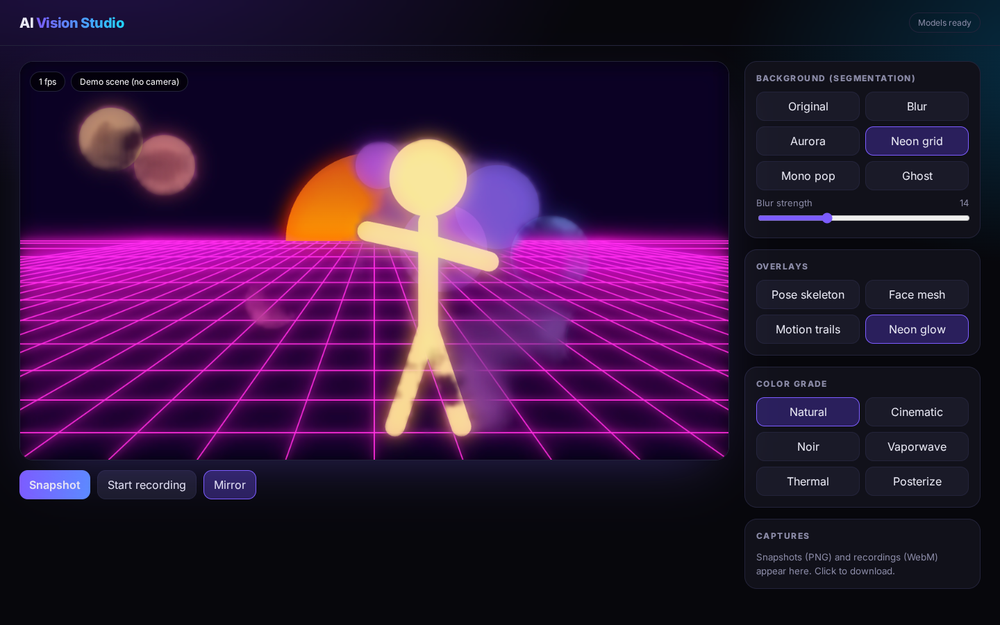

# AI Vision Studio

Real-time webcam AI effects in the browser: person segmentation, pose tracking and a 478 point face mesh with filters, color grades, snapshots and video recording.

**Live demo:** https://josephbepocode.github.io/ai-vision-studio/



## Features

- **Background effects (selfie segmentation):** blur, animated aurora, synthwave neon grid, mono pop, ghost.
- **Overlays:** pose skeleton (MediaPipe Pose Landmarker lite), face mesh (Face Landmarker), motion trails from hands and feet, neon glow.
- **Color grades:** cinematic with letterbox, noir, vaporwave, thermal, posterize.
- **Capture:** PNG snapshots and WebM recordings of the processed canvas (MediaRecorder), with a download gallery.
- **Demo scene:** works without a camera (`?demo`) using a procedurally animated figure.
- **Privacy:** every frame is processed on device. Nothing is uploaded.

## Tech

MediaPipe Tasks Vision 0.10.14 (WASM + GPU delegate), Canvas 2D, MediaRecorder. Models load lazily the first time an effect needs them (selfie segmenter about 250 KB, pose lite about 5 MB, face landmarker about 3.6 MB).

Fully static: no server, no API keys, no paid services. Hosted on GitHub Pages.

## Run locally

```bash
git clone https://github.com/josephbepocode/ai-vision-studio.git
cd ai-vision-studio
python3 -m http.server 8000
# open http://localhost:8000
```

## Notes and limitations

Needs a browser with WebAssembly and camera permission (HTTPS, which GitHub Pages provides). Recording format depends on the browser (WebM in Chrome and Firefox, MP4 in Safari). Performance depends on the device GPU.

## License

MIT, built by Deji ([@josephbepocode](https://github.com/josephbepocode)).
